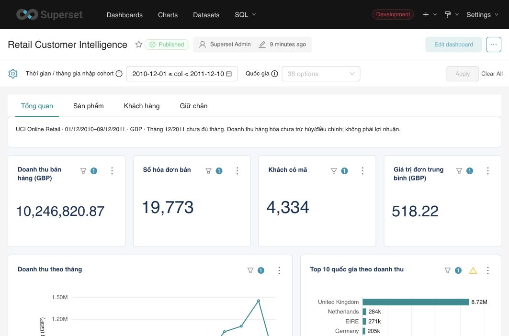

# Retail Customer Intelligence — PostgreSQL + Apache Superset

Phân tích bán hàng, sản phẩm, RFM và cohort từ **UCI Online Retail**. Dashboard thật đã triển khai với tông **navy + teal**, 4 tab, 24 biểu đồ, 5 dataset và bộ lọc thời gian/quốc gia.

[Mở dashboard local](http://127.0.0.1:8088/superset/dashboard/retail-customer-intelligence/).

Dữ liệu lịch sử **01/12/2010–09/12/2011**. Doanh thu bán hàng bên dưới là giá trị hàng hóa bán dương, **chưa trừ các dòng hủy/điều chỉnh**, không phải lợi nhuận. Dữ liệu demo mô phỏng trước đây không được nạp vào PostgreSQL hoặc Superset.



## Mở project bằng VS Code

```bash
git clone https://github.com/zuzuczung/retail-customer-intelligence.git
cd retail-customer-intelligence
code .
```

Toàn bộ SQL, Python, kiểm thử, tài liệu và kết quả kiểm chứng nằm trong một thư mục. Dùng `bash run.sh all` trong terminal VS Code khi PostgreSQL/Superset local đã sẵn sàng; hoặc chọn một tác vụ trong **Terminal → Run Task**. Các yêu cầu môi trường và xác thực nằm ở phần Chạy lại. GitHub lưu mã nguồn và ảnh minh họa; địa chỉ localhost cần dịch vụ chạy trên máy người xem.

## Kết quả và kiểm chứng

| Chỉ tiêu | Kết quả |
|---|---:|
| Dòng nguồn UCI | 541.909 |
| Dòng trùng hoàn toàn, loại khỏi analytics | 5.268 |
| Dòng bán hàng hóa hợp lệ sau làm sạch | 522.504 |
| Hóa đơn bán | 19.773 |
| Khách có mã | 4.334 |
| Doanh thu bán hàng | £10.246.820,87 |
| Giá trị dòng hủy/điều chỉnh âm, trình bày giá trị tuyệt đối | £475.901,16 |
| Hóa đơn thiếu mã khách | 1.371 |
| Kiểm tra nguồn/mô hình | 19/19 đạt |
| Đối soát chart với SQL qua 5 tình huống | 120/120 đạt |
| Kiểm thử quy tắc và mô hình | 10/10 đạt |

Kiểm tra chart gồm toàn bộ dữ liệu, France, quý I/2011, France trong quý I/2011 và bộ lọc không có dữ liệu. Chạy lại script dựng dashboard giữ nguyên UUID/ID database, dataset, chart và dashboard.

## Dashboard

| Tab | Nội dung | Bộ lọc thời gian |
|---|---|---|
| Tổng quan | Doanh thu, số hóa đơn, khách có mã, AOV, xu hướng, Top 10 quốc gia, Top 5 sản phẩm | Ngày mua |
| Sản phẩm | Số lượng, số mã hàng, hủy/điều chỉnh, Top 10 theo giá trị/số lượng, chi tiết Top 30 | Ngày mua; ngày ghi nhận dòng âm đối với hủy/điều chỉnh |
| Khách hàng | Snapshot RFM, phân nhóm, giá trị mua, danh sách khách | **Không áp dụng**; snapshot toàn bộ lịch sử chốt 10/12/2011 |
| Giữ chân | Quy mô cohort, tỷ lệ M1, heatmap và đường tỷ lệ theo tuổi cohort | **Tháng mua đầu tiên trong nguồn** |

Bộ lọc quốc gia áp dụng cho mọi tab. Với khách có mã, quốc gia được gán theo lần mua hợp lệ đầu tiên trong nguồn để attribution nhất quán; với khách thiếu mã, dùng quốc gia giao dịch.

Cohort chỉ dùng các tháng hoàn chỉnh đến **11/2011**. Tháng chưa quan sát giữ trống. M1 = **932 / 3.970 = 23,48%**; không lấy trung bình đơn giản của các tỷ lệ nhóm. Số khách đủ điều kiện thay đổi theo tuổi cohort, nên đường tỷ lệ gộp không thể được đọc như một xu hướng của cùng một nhóm cố định.

Hai dòng bán lớn £168.469,60 và £77.183,60 có dòng âm cùng mã/số lượng trong nguồn. Project giữ chúng và trình bày hủy/điều chỉnh riêng; không suy nhu cầu thực từ sản lượng bán gộp. Chưa có mã liên kết nguồn để khẳng định tất cả dòng âm là hoàn tiền của một hóa đơn cụ thể.

## Tổ chức dữ liệu

Database riêng: `retail_customer_intelligence`, PostgreSQL 17.10 trong container local `postgres-local`. Pipeline dùng role chủ sở hữu `retail_bi`; Superset dùng role chỉ đọc `retail_reader`, không được đọc staging hay ghi dữ liệu. Database Superset mới: `Retail Customer Intelligence`.

| Đối tượng | Grain / mục đích |
|---|---|
| `staging.invoice_line` | Một dòng nguồn Excel, giữ trường gốc dạng text và source_row |
| `staging.load_audit` | Lần nạp, checksum và số dòng |
| `analytics.classified_line` | Mọi dòng nguồn, có phân loại và cờ trùng |
| `analytics.fact_line` | Một dòng bán hàng hóa hợp lệ đã khử trùng |
| `analytics.fact_order` | Một hóa đơn bán; tổng hợp dòng hàng trước khi dùng BI |
| `analytics.dim_product`, `dim_customer`, `dim_date` | Danh mục, khách/quốc gia lần mua đầu, lịch |
| `analytics.v_adjustment` | Dòng âm hàng hóa hợp lệ, tách khỏi doanh thu bán dương |
| `analytics.customer_rfm` | Một khách có mã, snapshot R/F/M tại cuối nguồn |
| `analytics.cohort_retention` | Cohort × quốc gia × tuổi tháng, gồm cả tỷ lệ 0 thật |

42 hóa đơn có hai timestamp cách nhau một phút. Mọi dòng phân tích của một hóa đơn dùng thời gian sớm nhất, giữ `source_purchased_at` và staging gốc để truy vết.

## Chạy lại

Yêu cầu Python 3.11+, Docker đang chạy với PostgreSQL/Superset local đã có trong workspace. Chạy từ thư mục project:

```bash
python3 -m venv .venv
.venv/bin/pip install -e .
.venv/bin/retail-bi download
.venv/bin/retail-bi extract
.venv/bin/retail-bi bootstrap
.venv/bin/retail-bi load
.venv/bin/retail-bi dashboard
.venv/bin/retail-bi verify
.venv/bin/python -m unittest discover -s tests -v
```

Có thể dùng `.venv/bin/retail-bi all` để chạy từ tải nguồn đến dựng/đối soát dashboard. Bản triển khai đầu đọc XLSX bằng Python/openpyxl của runtime đi kèm Codex; pipeline SQL và API dùng môi trường project đã ghim dependency.

`bootstrap` chỉ tạo/cấp quyền database và hai role mang marker project. `.env` được sinh với quyền file 0600 và bị loại khỏi Git. Script từ chối nhận lại database/role/resource không thuộc project. `load` thay staging/analytics trong database riêng, giữ load audit và chạy transaction; không đụng đến các database Olist/Amazon. Nếu kiểm tra sau nạp thất bại, dừng trước khi dựng dashboard.

Superset: dùng biến môi trường `SUPERSET_ACCESS_TOKEN` hoặc `SUPERSET_USERNAME`/`SUPERSET_PASSWORD`. Trong môi trường local đã triển khai, `SUPERSET_DOCKER_CONTAINER=superset_app` cho phép tạo phiên API ngắn hạn cho admin hiện có qua app context; không tạo user, đổi password hoặc lưu token. Nếu chuyển máy, cấu hình lại cách xác thực và URI PostgreSQL theo môi trường đích.

## Nguồn và bằng chứng

- [UCI Online Retail](https://archive.ics.uci.edu/dataset/352/online+retail): Chen, D. (2015), DOI [10.24432/C5BW33](https://doi.org/10.24432/C5BW33), giấy phép CC BY 4.0.
- `source-manifest.json`: nguồn tải, ngày nhận, checksum ZIP/XLSX đã ghim.
- `docs/data-contract.md`: điều kiện hợp lệ, grain, định nghĩa KPI, RFM/cohort và kế hoạch kiểm tra.
- `docs/project_report.md`: đánh giá theo 5 bước, phân biệt kết quả đã làm, bằng chứng, hạn chế và phần đề xuất.
- `artifacts/source-profile.json`, `data-validation.json`: kiểm tra độc lập từ XLSX và đối soát PostgreSQL.
- `artifacts/chart-validation.json`, `idempotency.json`: đối soát biểu đồ, bộ lọc và tài nguyên chạy lại.
- `artifacts/deployment.json`: địa chỉ và ID các tài nguyên thực.
- `artifacts/retail_superset_dashboard_export.zip`: export dashboard Superset; dữ liệu PostgreSQL và thông tin đăng nhập không nằm trong bản export.

Các file raw/interim, môi trường ảo, thông tin đăng nhập và bản xem trước thiết kế được loại khỏi Git. Bản export Superset đã kiểm tra không chứa mật khẩu database dạng rõ. Dashboard hiện tại chỉ dùng dữ liệu UCI thật.
